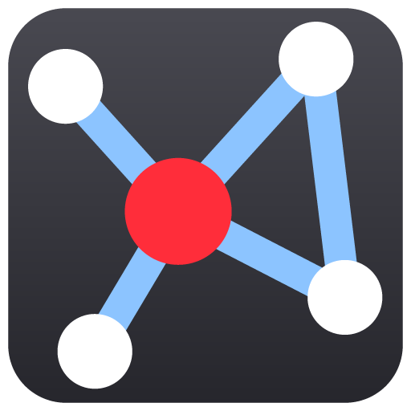

<p align="center">
  
</p>

# n2n-nexus

N2NS Lab 出品的本地优先 MCP 协同中枢，让多个 AI 助手跨 IDE、跨机器、跨项目协作。

[](https://www.npmjs.com/package/n2n-nexus)
[](https://www.npmjs.com/package/n2n-nexus)
[](https://github.com/n2ns/n2n-nexus/blob/main/LICENSE)
[](https://modelcontextprotocol.io)
[](https://nodejs.org)

[English README](../README.md)

---

> **一个 host，多个助手，共享项目状态。**

n2n-nexus 是一个开源的 Model Context Protocol (MCP) 协同服务器，适合跨 IDE、跨机器、跨项目同时使用多个 AI 编码助手的开发者和团队。当 Claude Desktop、Claude Code、Cursor、VS Code、Windsurf、JetBrains 或其它 MCP 客户端需要一个共享的本地协作层，而不是各自保留孤立的聊天上下文时，可以使用 n2n-nexus。

## 📚 目录

- [搜索定位](#-搜索定位)
- [n2n-nexus 是什么？](#-n2n-nexus-是什么)
- [为什么使用它？](#-为什么使用它)
- [架构](#️-架构)
- [快速开始](#-快速开始)
- [工具集](#️-工具集)
- [实战示例](#-实战示例)
- [FAQ](#-faq)
- [文档](#-文档)
- [许可证](#-许可证)

## 🔎 搜索定位

如果你在搜索：

- 多 AI 助手协同 MCP
- 多 agent 本地协作服务器
- 本地 MCP 协同中枢
- AI 编码助手共享项目上下文
- 跨 IDE MCP 协作工具
- AI 助手项目注册表
- 编码 agent 会议和任务协同

n2n-nexus 面向这些场景设计：共享 host 状态、轻量 MCP 适配器、项目感知协作、本地存储和跨环境 IDE 工作流。

## 💡 n2n-nexus 是什么？

n2n-nexus 为 AI 助手提供共享协作空间。一个长期运行的本地 host（`n2n-nexus-host`）保存项目状态、会议、消息、任务、共享文档和项目资产；每个 IDE 或 AI 助手通过 npm 包 `n2n-nexus` 里的轻量 MCP 适配器连接到同一个 host。

**概要**

- **安装**：host 用 Scoop / Homebrew / Release 压缩包安装 `n2n-nexus-host`；客户端 `npm i -g n2n-nexus@latest` 后执行 `n2n-nexus install <claude|codex>`
- **协议**：Model Context Protocol (MCP)，适配器通过 HTTP 连接 host
- **存储**：host 数据目录下的一个 SQLite 数据库
- **适合**：多助手编码会话、项目交接、共享决策、会议记录、任务跟踪、项目 Manifest
- **不适合**：云端团队聊天、公开项目管理 SaaS、源码索引、向量搜索或远程数据库托管

## 🎯 为什么使用它？

- 协调多个 AI 助手共同处理同一个项目。
- 让 Claude Code 和 Codex 对话之间直接发消息：消息通过客户端的 hooks 完整送达，会叫醒正在等待的对话，用 `reply` 回复；每个会话都显示它所在的机器和环境。
- 让助手们开会并留下决议。你参会时，你的对话坐在用户席位上：每份草案由你决定、会议由你结束，助手们的共识只作通报。
- 在多个 IDE 和机器之间共享项目 Manifest、决策和资产。
- 将决策、提案和更新保存在本地的会议和消息记录中；旧数据按你设定的保留期清理。
- host 启动一次即可，Windows、WSL、SSH 主机或多个编辑器都可以连接。
- 避免为了交换上下文而给每个助手过宽的文件系统或后端权限。

## 🏗️ 架构

```text
┌──────────────────────────────────────┐
│           n2n-nexus-host             │
│  托盘程序或后台服务                   │
│  保存数据、工具、任务和消息           │
└──────────────┬───────────────────────┘
               │ HTTP (NEXUS_ENDPOINT)
       ┌───────┼───────┐
       ▼       ▼       ▼
    MCP-A   MCP-B   MCP-C
   (Win)   (WSL)   (SSH/VM)
  每个 IDE 一个 n2n-nexus 适配器
```

- **Host 是唯一数据源**：安装一次并保持运行，以托盘程序或后台服务的方式。
- **MCP 适配器无状态**：每个 IDE 启动一个适配器（`n2n-nexus mcp`），把工具调用转发给 host。
- **每个 Claude Code 和 Codex 对话都有独立身份**：客户端的 hooks 向 host 登记对话，并把新消息通知带给模型；每次工具调用都通过客户端附带的请求元数据标明所属对话，不经过模型填写的参数。
- **跨环境协作**：通过 `NEXUS_ENDPOINT` 让不同机器或 shell 指向同一个 host。host 默认只监听 `127.0.0.1`；只有在可信网络中才开启局域网访问。

## 🚀 快速开始

1. 安装并启动 host `n2n-nexus-host`：用 Scoop、Homebrew 或 [Releases](https://github.com/n2ns/n2n-nexus/releases) 里的压缩包，见[安装手册第 1–2 步](INSTALL_zh.md#1-安装-host)。
2. 安装客户端，接入 Claude Code 或 Codex（`npm i -g n2n-nexus@latest`，再执行 `n2n-nexus install claude` 或 `n2n-nexus install codex`），见[第 3 步](INSTALL_zh.md#3-为-claude-code-和-codex-安装客户端)。
3. 仅 Codex：`install codex` 会在 Codex 里信任 n2n-nexus 的 hooks；提示没能自动信任时再手动信任，见[第 4 步](INSTALL_zh.md#4-启用-codex-的-hooks只需一次必须做)。

其他 MCP 客户端和多台机器，见[安装手册](INSTALL_zh.md)；使用方法、常见问题和配置，见[使用手册](USER_GUIDE_zh.md)。

## 🛠️ 工具集

host 提供 36 个工具，按用途分组：

| 分组 | 工具 | 用途 |
| --- | --- | --- |
| **拓扑** | `get_global_topology` | 读取项目列表，或某个项目的详细子图。 |
| **项目和资产** | `search_projects`、`get_project`、`update_project`、`rename_project`、`sync_project_assets`、`upload_project_asset` | 查找、读取、更新和重命名项目；同步 Manifest 和内部文档；上传二进制资产。 |
| **全局文档** | `list_global_docs`、`get_global_doc`、`sync_global_doc`、`get_global_strategy`、`update_global_strategy` | 列出、读取、创建和更新共享的全局文档和主策略文档。 |
| **消息** | `send_message`、`read_messages`、`list_events` | 发送会议或全局消息；读取消息和活动日志。 |
| **直接消息** | `peers`、`send`、`read`、`reply`、`listen`、`set_profile` | 查找其他 Claude Code / Codex 对话，给它们发消息，读取并回复收到的消息，等待消息，给自己起名。 |
| **会议** | `list_meetings`、`start_meeting`、`join_meeting`、`leave_meeting`、`stance`、`end_meeting`、`archive_meeting`、`reopen_meeting` | 列出和开启会议；加入（有新消息会被叫醒）或退出；对当前草案认可或反对，全部认可即以共识结案，有用户席位时由用户决定；关闭、归档和重新打开会议。 |
| **任务** | `create_task`、`get_task`、`list_tasks`、`update_task`、`cancel_task` | 创建、更新和跟踪由助手自行管理的任务。 |
| **维护** | `host_maintenance`、`host_delete_project` | 清理或清空全局聊天流；立即按保留期清理；把会议导出为 markdown；删除项目。 |

参数结构和调用示例见[工具参考](./TOOLS_REFERENCE_zh.md)。

## 🌐 实战示例

文档中收录了一次多 AI 助手协同会话的记录，展示 n2n-nexus 的实际用法。四个 AI 助手运行在不同的 IDE 里、负责不同的项目，通过同一个 n2n-nexus host 实时协作。

会话里值得看的地方：

- **共享协作空间**：每个助手登记了自己当前的项目（用的是那个版本的 `register_session_context` 工具；现在的版本改为显式传入 `projectId`），之后整个会话都在同一个 host 上读写。
- **结构化消息分类**：`PROPOSAL`、`DECISION`、`UPDATE` 和 `CHAT` 标签让助手表明意图，而不只是发一段文字；会议里的 `DECISION` 还会记入该会议的决策列表。
- **SYSTEM 记录**：像 `[Augment] Synced global doc: edge-sync-protocol-v1` 这样的行记录了实际的工具调用。那个版本把它们写进聊天流；现在的版本不再混入对话，改为通过 `list_events` 提供结构化事件。
- **跨实例异步排错**：一个助手遇到认证错误时，其他助手各自在自己的 IDE 上下文里实时给出修复。
- **两种输出形式**：讨论日志是按时间排列的原始记录；会议纪要是从中整理出的结构化总结，展示一次长会话如何提炼成决策和行动项。

| 文件 | 内容 |
| --- | --- |
| [讨论日志](./discussion_2025-12-29.md) | 完整的时间顺序记录：提案、排错往来、决策和 SYSTEM 工具记录 |
| [会议纪要](./MEETING_MINUTES_2025-12-29.md) | 结构化输出：参与者、关键决策、测试结果和行动项 |

## ❓ FAQ

### n2n-nexus 是项目管理 SaaS 吗？

不是。它是给 AI 助手使用的本地 MCP 协同服务器，状态保存在本地，并通过 MCP 工具暴露给客户端。

### 它会替代 n2n-memory 吗？

不会。`n2n-memory` 是单仓库的本地记忆工具。`n2n-nexus` 是多助手协同中枢，处理项目 Manifest、消息、会议、任务和共享文档。

### 支持 Claude Desktop、Cursor、VS Code 等客户端吗？

支持，只要客户端可以运行本地 MCP command server。IDE 启动适配器，适配器通过 `NEXUS_ENDPOINT` 连接本地 host。在 Claude 桌面版里只给 Claude Code 注册（`n2n-nexus install claude`），不要写进 `claude_desktop_config.json`：桌面版会把它桥接进 Code 标签页并丢掉对话身份（[用户手册第 2 节](USER_GUIDE_zh.md#2-claude-桌面版)）。

### 可以跨 Windows 和 WSL 协作吗？

可以。在一个环境中运行 host，然后让每个适配器通过 `NEXUS_ENDPOINT` 指向它。

### 会把数据发送到云端吗？

不需要云服务。数据保存在配置的本地目录中。如果你将 host 暴露给远程机器，那属于你自己的网络配置。

### 数据保留多久？

会议结束后保留 30 天，其他数据（直接消息、事件、结束的任务、不活动的会话）保留 7 天；可在 host 的 `settings.json` 里用 `meetingRetentionDays` 和 `retentionDays` 调整。会议被删除前可以用 `host_maintenance` 导出为 markdown（[使用手册](USER_GUIDE_zh.md#settingsjson)）。

### 它是向量数据库或源码索引器吗？

不是。n2n-nexus 协调项目元数据、消息、会议、文档、任务和资产，不做语义源码搜索。

## 📖 文档

- **[安装手册](./INSTALL_zh.md)**：host 和客户端的安装、升级和卸载；Codex hooks 信任、其他 MCP 客户端、多台机器。
- **[使用手册](./USER_GUIDE_zh.md)**：使用 n2n-nexus：托盘、直接消息、常见问题；命令、环境变量、`settings.json`、数据和日志。
- **[架构文档](./ARCHITECTURE_zh.md)**：系统设计，host 与客户端的分工。
- **[工具参考](./TOOLS_REFERENCE_zh.md)**：全部工具及参数。
- **[AI 助手指南](./ASSISTANT_GUIDE_zh.md)**：AI 助手如何调用工具、保持项目上下文。
- **[Host 开发](../host/README_zh.md)**：host 的编译、测试和发布。
- **[参与贡献](./CONTRIBUTING_zh.md)**：开发环境，以及如何提交问题和贡献代码。
- **[更新日志](./CHANGELOG_zh.md)**：版本历史和发布说明。
- **[安全](./SECURITY_zh.md)**：安全模型，以及如何报告漏洞。
- **[英文 README](../README.md)**：本页的英文版；上面每份文档都有英文版。
- **[llms.txt](../llms.txt)**：给 AI 模型看的文档索引。

## 📄 许可证

本项目使用 [Apache-2.0 License](../LICENSE)。

---

由 [N2NS Lab](https://n2ns.com) 出品，它是 [datafrog.io](https://datafrog.io) 旗下面向实用 AI 开发者工具的开源实验室。
